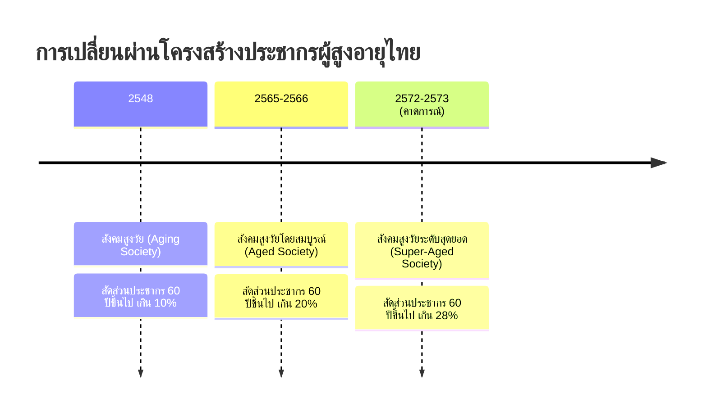
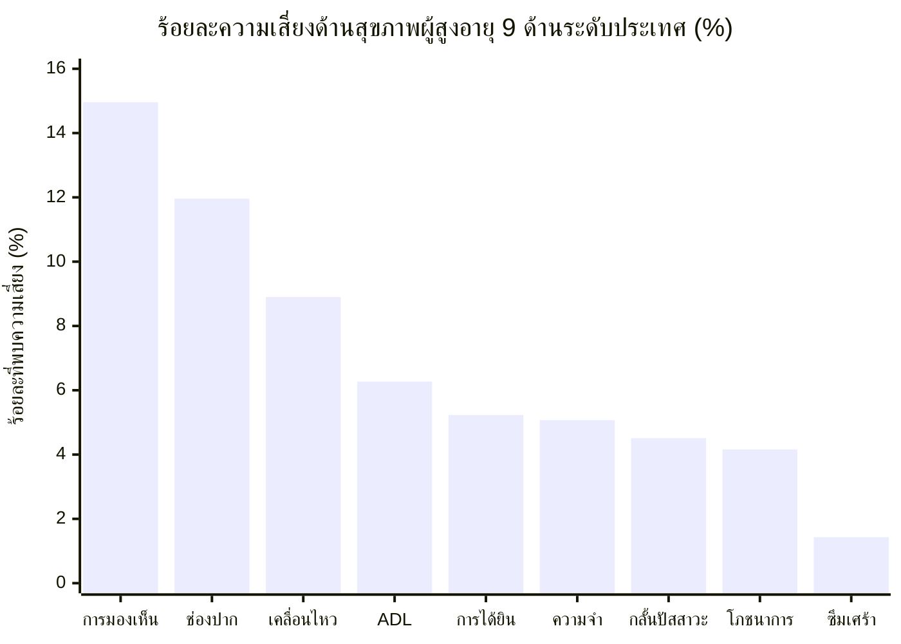
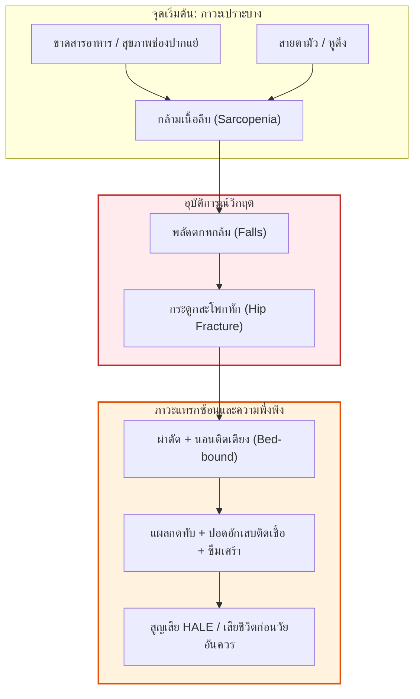
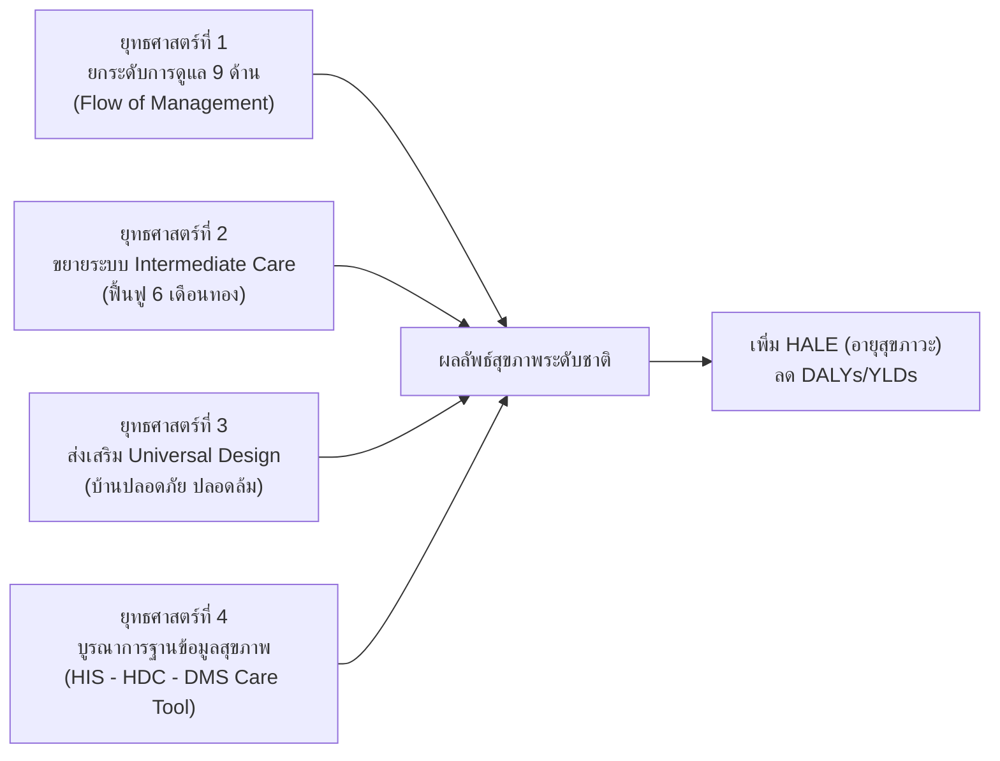

# รายงานวิเคราะห์สถานการณ์ด้านผู้สูงอายุของประเทศไทย
## เจาะลึกวิกฤตสุขภาพผู้สูงอายุ ข้อมูลเชิงประจักษ์ 9 ด้าน และทิศทางเชิงยุทธศาสตร์ระบบบริการสุขภาพ

---

**จัดทำเพื่อ:** การวิเคราะห์เชิงยุทธศาสตร์ นโยบายสาธารณสุข และการพัฒนาระบบบริการสุขภาพรองรับสังคมสูงวัยระดับสุดยอด  
**กรอบการอ้างอิง:** กระทรวงสาธารณสุข (สป.สธ., กรมการแพทย์, สถาบันเวชศาสตร์สมเด็จพระสังฆราชญาณสังวรเพื่อผู้สูงอายุ, กรมอนามัย, กรมควบคุมโรค)  
**แหล่งข้อมูลสถิติ:** 
* ระบบคลังข้อมูลด้านการแพทย์และสุขภาพ (Health Data Center: HDC)
* ระบบติดตามการดูแลสุขภาพผู้สูงอายุ (DMS Care Tool) กรมการแพทย์
* รายงานสถิติสาธารณสุข และสำนักงานสถิติแห่งชาติ

---

## สารบัญ (Table of Contents)

1. [บทสรุปผู้บริหาร (Executive Summary)](#1-บทสรุปผู้บริหาร-executive-summary)
2. [บริบททางประชากรศาสตร์: การเปลี่ยนผ่านสู่ Super-Aged Society](#2-บริบททางประชากรศาสตร์-การเปลี่ยนผ่านสู่-super-aged-society)
3. [ระบาดวิทยาและภาระโรคในผู้สูงอายุไทย (Epidemiology & Burden of Diseases)](#3-ระบาดวิทยาและภาระโรคในผู้สูงอายุไทย)
4. [บทวิเคราะห์เชิงประจักษ์: การคัดกรองสุขภาพผู้สูงอายุ 9 ด้านระดับประเทศ](#4-บทวิเคราะห์เชิงประจักษ์-การคัดกรองสุขภาพผู้สูงอายุ-9-ด้านระดับประเทศ)
5. [กลุ่มอาการผู้สูงอายุและวงจรความถดถอย (Geriatric Syndromes & Frailty)](#5-กลุ่มอาการผู้สูงอายุและวงจรความถดถอย)
6. [ภาวะพึ่งพิงและวิกฤตผู้ดูแล (Functional Dependency & Caregiver Crisis)](#6-ภาวะพึ่งพิงและวิกฤตผู้ดูแล)
7. [ช่องว่างและความท้าทายเชิงระบบสาธารณสุข (Systemic Gaps & Bottlenecks)](#7-ช่องว่างและความท้าทายเชิงระบบสาธารณสุข)
8. [ข้อเสนอแนะเชิงยุทธศาสตร์และนโยบาย (Strategic Policy Recommendations)](#8-ข้อเสนอแนะเชิงยุทธศาสตร์และนโยบาย)
9. [เป้าหมายผลลัพธ์สุขภาพระยะยาว: HALE และ DALYs/YLDs](#9-เป้าหมายผลลัพธ์สุขภาพระยะยาว-hale-และ-dalysylds)

---

## 1. บทสรุปผู้บริหาร (Executive Summary)

ประเทศไทยได้ก้าวพ้นสถานะ **"สังคมสูงวัยอย่างสมบูรณ์" (Aged Society)** ที่มีสัดส่วนประชากรอายุ 60 ปีขึ้นไปเกิน 20% แล้วอย่างเป็นทางการ และกำลังมุ่งหน้าสู่ **"สังคมสูงวัยระดับสุดยอด" (Super-Aged Society)** ภายในช่วงปี **พ.ศ. 2572–2573** ซึ่งคาดว่าจะมีสัดส่วนประชากรสูงวัยเกิน 28% ของประชากรทั้งหมด

### ประเด็นวิกฤตสุขภาพที่สำคัญ:
* **"แก่ก่อนรวย" (Old Before Rich):** ประชากรสูงอายุเพิ่มขึ้นอย่างรวดเร็วท่ามกลางอัตราการเจริญพันธุ์รวม (TFR) ที่ลดต่ำลงวิกฤต (<1.16) และสัดส่วนการออมหรือเบี้ยยังชีพที่ไม่สอดรับกับค่าครองชีพ
* **ภาระโรคเรื้อรังซ้ำซ้อน (Multimorbidity & Polypharmacy):** ผู้สูงอายุมากกว่า 70% มีโรคไม่ติดต่อเรื้อรัง (NCDs) อย่างน้อย 1 โรค และกว่าครึ่งมีโรคร่วมตั้งแต่ 2 โรคขึ้นไป ทำให้ต้องรับประทานยาประจำตั้งแต่ 5 ขนานขึ้นไป
* **วิกฤตความเสี่ยงจากการคัดกรอง 9 ด้าน (ระดับประเทศ):**
  1. *การมองเห็น (Vision):* เสี่ยงสูงสุดอันดับ 1 คิดเป็น **14.96%** (>1.37 ล้านคน) นำไปสู่การพลัดตกหกล้ม
  2. *สุขภาพช่องปาก (Oral Health):* เสี่ยงอันดับ 2 คิดเป็น **11.96%** (>1.10 ล้านคน) กระทบต่อภาวะโภชนาการและการสำลัก
  3. *การเคลื่อนไหว (Mobility):* เสี่ยงอันดับ 3 คิดเป็น **8.90%** (~8.2 แสนคน) นำไปสู่วงจรกล้ามเนื้อลีบและการติดเตียง
* **ช่องว่างระหว่างการคัดกรองสู่การรักษา (Screening-to-Care Gap):** ในอดีตมุ่งเน้นเพียงปริมาณการคัดกรอง แต่ขาดการดูแลรักษาต่อเนื่องตามขั้นตอนทางคลินิก (Flow of Management) จึงเป็นที่มาของการขับเคลื่อนตัวชี้วัดกระทรวงสาธารณสุขปี 2570 เพื่อผลักดันให้ผู้สูงอายุที่พบความเสี่ยงได้รับการดูแลไม่น้อยกว่าร้อยละ 70

---

## 2. บริบททางประชากรศาสตร์: การเปลี่ยนผ่านสู่ Super-Aged Society

โครงสร้างประชากรไทยเปลี่ยนแปลงจากรูปปิรามิดฐานกว้างสู่ทรงกระบอกฐานคอด (Inverted Aging Pyramid) อย่างสมบูรณ์:

### ลักษณะเฉพาะของวิกฤตสูงวัยในไทย:
1. **ความเร็วของการเปลี่ยนผ่าน:** ประเทศไทยใช้เวลาเพียง ~20 ปีในการก้าวจาก Aging Society สู่ Super-Aged Society ซึ่งเร็วกว่าหลายประเทศในยุโรปที่ใช้เวลาเฉลี่ย 40–70 ปี
2. **อัตราการพึ่งพิงทางประชากร (Dependency Ratio) พุ่งสูง:** ในอดีตแรงงาน 6-7 คนดูแลผู้สูงอายุ 1 คน ปัจจุบันเหลืออัตราส่วนแรงงานไม่ถึง 3 คนต่อผู้สูงอายุ 1 คน และในอนาคตอันใกล้จะเหลือเพียง 1.7 ต่อ 1 คน
3. **การกลายสภาพของครัวเรือน (Household Restructuring):** ผู้สูงอายุที่อาศัยอยู่ลำพังคนเดียว (Living alone) หรืออยู่กันตามลำพังเพียงคู่สามีภรรยา (Skipped-generation households) มีแนวโน้มเพิ่มขึ้นมากกว่าร้อยละ 20

---

## 3. ระบาดวิทยาและภาระโรคในผู้สูงอายุไทย

### 3.1 ภาระจากกลุ่มโรคไม่ติดต่อเรื้อรัง (NCDs)
โรคเรื้อรังเป็นสาเหตุสำคัญของการสูญเสียปีสุขภาวะ (Disability-Adjusted Life Years: DALYs) และค่าใช้จ่ายระบบบริการสุขภาพ:

1. **โรคความดันโลหิตสูง (Hypertension):** ความชุกมากกว่า 50% ของผู้สูงอายุทั่วประเทศ มักไม่แสดงอาการในช่วงแรก แต่เป็นตัวเร่งสำคัญของโรคไตและหลอดเลือด
2. **โรคเบาหวาน ชนิดที่ 2 (Diabetes Mellitus):** ความชุกประมาณ 20–25% นำไปสู่ภาวะแทรกซ้อนปลายประสาทเสื่อม แผลเบาหวานที่เท้า จอประสาทตาเสื่อม และไตวายเรื้อรัง
3. **โรคหลอดเลือดสมองและหัวใจ (Stroke & CVD):** อัตราการเกิด Stroke เป็นสาเหตุหลักของการเสียชีวิตเฉียบพลัน และเป็นสาเหตุอันดับ 1 ของความพิการระยะยาว
4. **โรคไตวายเรื้อรังระยะสุดท้าย (End-Stage Renal Disease - ESRD):** จำนวนผู้สูงอายุที่ต้องได้รับการบำบัดทดแทนไต (ล้างไตทางช่องท้อง / ฟอกเลือด) เติบโตต่อเนื่อง ส่งผลกระทบอย่างสูงต่องบประมาณระบบบัตรทอง (UC Fund)

### 3.2 ภาวะพหุพยาธิสภาพและการใช้ยาหลายขนาน (Multimorbidity & Polypharmacy)
* ผู้สูงอายุไทยมีโรคร่วมเฉลี่ย **2–4 โรคต่อคน**
* การได้รับยามากกว่า 5 รายการขึ้นไป (Polypharmacy) พบได้มากกว่า 40% ในคลินิกโรคเรื้อรัง
* **ความเสี่ยงทางคลินิก:** อาการข้างเคียงจากยา (Adverse Drug Events), ความดันตกเมื่อเปลี่ยนท่าทาง (Orthostatic Hypotension), ภาวะง่วงซึมสับสนเฉียบพลัน (Delirium) ซึ่งเป็นสาเหตุทางอ้อมที่ทำให้เกิดการพลัดตกหกล้ม

---

## 4. บทวิเคราะห์เชิงประจักษ์: การคัดกรองสุขภาพผู้สูงอายุ 9 ด้านระดับประเทศ

จากฐานข้อมูลคลังข้อมูลด้านการแพทย์และสุขภาพ (Health Data Center: HDC) กรมการแพทย์ และสถาบันเวชศาสตร์สมเด็จพระสังฆราชญาณสังวรเพื่อผู้สูงอายุ ที่มีการคัดกรองผู้สูงอายุทั่วประเทศกว่า **10,997,716 ราย** (คัดกรองครบ 9 ด้านจำนวน **8,866,219 ราย** หรือ 80.62%) ปรากฏข้อมูลสถิติความเสี่ยง ดังนี้:

### ตารางสถิติผลการคัดกรองความเสี่ยง 9 ด้าน (National Screening Summary)

| ลำดับที่ | มิติสุขภาพ (9 ด้าน) | จำนวนผู้รับการคัดกรอง (ราย) | ตรวจพบความเสี่ยง (ราย) | ร้อยละความเสี่ยง (%) | สถานะความเร่งด่วน |
| :---: | :--- | :---: | :---: | :---: | :---: |
| **1** | **การมองเห็น (Vision)** | 9,201,903 | **1,376,294** | **14.96%** | **วิกฤตสูงสุด** |
| **2** | **สุขภาพช่องปาก (Oral Health)** | 9,220,393 | **1,102,545** | **11.96%** | **วิกฤตสูง** |
| **3** | **การเคลื่อนไหวร่างกาย (Mobility)** | 9,210,910 | **819,925** | **8.90%** | **วิกฤตสูง** |
| **4** | **การทำกิจวัตรประจำวัน (ADL)** | 9,399,604 | **589,184** | **6.27%** | ปานกลาง-สูง |
| **5** | **การได้ยิน (Hearing)** | 8,981,013 | **469,864** | **5.23%** | ปานกลาง |
| **6** | **ความคิดความจำ (Cognition)** | 8,787,530 | **445,671** | **5.07%** | ปานกลาง (ระเบิดเวลา) |
| **7** | **การกลั้นปัสสาวะ (Incontinence)** | 9,090,203 | **409,614** | **4.51%** | ปานกลาง |
| **8** | **ภาวะโภชนาการ (Nutrition)** | 8,980,871 | **373,211** | **4.16%** | ปานกลาง |
| **9** | **ภาวะซึมเศร้า 2Q (Depression)** | 9,233,137 | **131,971** | **1.43%** | เฝ้าระวังต่อเนื่อง |

### เจาะลึก 3 ปัญหาความเสี่ยงสูงสุด:
1. **มิติการมองเห็น (14.96% - เกือบ 1.38 ล้านคน):**
   * ปัญหาหลัก: ต้อกระจกตามวัย (Age-related cataract), สายตาเลือนราง, ต้อหิน และจุดภาพชัดจอประสาทตาเสื่อม
   * ผลกระทบ: ผู้สูงอายุสูญเสียมิติการมองเห็น (Depth perception) ก้าวพลาด ตกบันได สะดุดสิ่งกีดขวางในบ้าน
2. **มิติสุขภาพช่องปาก (11.96% - มากกว่า 1.1 ล้านคน):**
   * ปัญหาหลัก: มีฟันแท้ใช้งานได้น้อยกว่า 20 ซี่ หรือไม่มีฟันคู่สบสำหรับบดเคี้ยวอาหาร
   * ผลกระทบ: เคี้ยวเนื้อสัตว์และผักไม่ได้ หันมารับประทานแต่คาร์โบไฮเดรตหรืออาหารเหลว นำไปสู่การขาดโปรตีนและมวลกล้ามเนื้อลีบ และเสี่ยงต่อการสำลักเกิดปอดอักเสบ (Aspiration Pneumonia)
3. **มิติการเคลื่อนไหวและการทรงตัว (8.90% - ประมาณ 8.2 แสนคน):**
   * ปัญหาหลัก: โรคข้อเข่าเสื่อม (Osteoarthritis), ภาวะกระดูกบาง/พรุน (Osteoporosis) และภาวะกล้ามเนื้อลีบ (Sarcopenia)
   * ผลกระทบ: ลุกยืนลำบาก เดินเซ เสี่ยงต่อการหกล้มเฉียบพลัน

---

## 5. กลุ่มอาการผู้สูงอายุและวงจรความถดถอย (Geriatric Syndromes & Frailty)

ในเวชศาสตร์ผู้สูงอายุ การเจ็บป่วยไม่ได้จำกัดอยู่เพียงโรคใดโรคหนึ่ง แต่ส่งผลต่อกันเป็นลูกโซ่ผ่านกลุ่มอาการเฉพาะ:

---

## 6. ภาวะพึ่งพิงและวิกฤตผู้ดูแล (Functional Dependency & Caregiver Crisis)

### 6.1 การแบ่งกลุ่มตามศักยภาพทางกายภาพ:
* **กลุ่มติดสังคม (~75–80%):** ทำกิจวัตรประจำวันได้เองทั้งหมด ช่วยเหลือครอบครัวและชุมชนได้ เป้าหมายคือการส่งเสริมให้มีสุขภาวะยืนยาว
* **กลุ่มติดบ้าน (~15–20%):** เริ่มมีปัญหาการเคลื่อนไหว ออกนอกบ้านลำบาก ต้องการคนช่วยบางส่วน หากไม่ฟื้นฟูอย่างเร่งด่วนจะกลายเป็นกลุ่มติดเตียง
* **กลุ่มติดเตียง (~1–3%):** ช่วยเหลือตนเองไม่ได้ ต้องการการดูแลตลอด 24 ชั่วโมง

### 6.2 วิกฤตผู้ดูแลในมิติสังคมและเศรษฐกิจ:
1. **Caregiver Shortage:** ขาดแคลนผู้ดูแลทั้งระดับครอบครัว (Informal Caregivers) และผู้ดูแลมืออาชีพ (Caregivers/Care Managers)
2. **Caregiver Burnout & Depression:** บุตรหลานที่ต้องลาออกจากงานมาดูแลพ่อแม่ที่ป่วยเรื้อรังหรือสมองเสื่อม เผชิญกับความเครียดสะสม การสูญเสียรายได้ และมีปัญหาสุขภาพจิต
3. **ภาวะสมองเสื่อม (Dementia Burden):** จากสถิติคัดกรองพบความเสี่ยงความคิดความจำมากกว่า 4.4 แสนคน ผู้ป่วยกลุ่มนี้เมื่อเข้าสู่ระยะกลางและระยะท้ายจะต้องการการดูแลประกบตลอดเวลา นำไปสู่วิกฤตในครอบครัวมากที่สุด

---

## 7. ช่องว่างและความท้าทายเชิงระบบสาธารณสุข (Systemic Gaps & Bottlenecks)

### 1. ช่องว่างจากการคัดกรองสู่การรักษา (Screening-to-Care Gap):
ในระยะที่ผ่านมา ระบบสาธารณสุขมีความเข้มแข็งในการคัดกรอง (Coverage) แต่ขาดกลไกเชื่อมต่อว่า **"เมื่อคัดกรองพบเสี่ยงแล้ว ผู้สูงอายุได้รับการดูแลรักษาจริงหรือไม่"**
* ขาดการส่งต่อไปยังแพทย์เฉพาะทางหรือคลินิกเฉพาะด้าน
* คิวการผ่าตัดต้อกระจกและบริการทันตกรรมในบางพื้นที่หนาแน่นเกินกำลังรองรับ

### 2. ระบบฟื้นฟูระยะกึ่งเฉียบพลัน (Intermediate Care: IMC) ขาดความต่อเนื่อง:
เมื่อผู้ป่วยสูงอายุผ่านพ้นวิกฤตเฉียบพลันจากโรงพยาบาลระดับจังหวัด (รพศ./รพท.) มักถูกส่งกลับบ้านโดยที่ระบบบริการฟื้นฟูกายภาพบำบัดในระดับชุมชน (รพช./รพ.สต.) ยังไม่มีเตียงฟื้นฟูหรืออุปกรณ์รองรับอย่างเพียงพอ ทำให้พลาดช่วง **6 เดือนทอง (Golden Period)** ในการฟื้นฟูสมรรถภาพ

### 3. รอยต่อของข้อมูลสารสนเทศ (Data Fragmentation):
* ข้อมูลในระบบ HIS ของโรงพยาบาล, คลังข้อมูล HDC และเครื่องมือบริหารจัดการการดูแล (DMS Care Tool) ยังขาดการเชื่อมโยงสองทาง (Bidirectional sync) แบบเรียลไทม์ ทำให้แพทย์และทีมปฐมภูมิไม่เห็นภาพรวมเดียวกัน

---

## 8. ข้อเสนอแนะเชิงยุทธศาสตร์และนโยบาย (Strategic Policy Recommendations)

### 1. ขับเคลื่อนตัวชี้วัดกระทรวงฯ: ร้อยละ 70 ของกลุ่มเสี่ยงต้องได้รับการดูแล
* กำหนดให้การดูแลตาม Flow of Management สุขภาพ 9 ด้าน เป็นวาระสำคัญของการตรวจราชการ
* ปรับกระบวนทัศน์จากการนับยอด "คัดกรอง" เป็นการนับผลงาน "การให้คำแนะนำ การวินิจฉัย การรักษา การฟื้นฟู หรือการส่งต่อ" ที่บันทึกรายบุคคลไม่ซ้ำ (Unique Person)

### 2. มาตรการเร่งรัด 3 ด้านวิกฤต (Targeted Interventions):
* **จักษุสาธารณสุข:** จัดตั้งหน่วยผ่าตัดต้อกระจกเคลื่อนที่ (Mobile Cataract Surgical Unit) เพื่อเคลียร์ค้างสะสมในกลุ่มเสี่ยง 1.37 ล้านคน
* **ทันตกรรมผู้สูงวัย:** ขยายสิทธิประโยชน์และหน่วยทันตกรรมชุมชน มอบฟันเทียมและฝึกสอนสุขอนามัยช่องปากเพื่อป้องกันการสำลัก
* **คลินิกป้องกันการหกล้มและฝึกกล้ามเนื้อ:** จัดตั้งกลุ่มออกกำลังกายป้องกันการล้มใน รพ.สต. และศูนย์พัฒนาคุณภาพชีวิตผู้สูงอายุในชุมชน

### 3. การวางระบบ Intermediate Care (IMC) ในโรงพยาบาลชุมชน:
* จัดสรรเตียงและงบประมาณเฉพาะสำหรับผู้ป่วย Stroke, Traumatic Brain Injury, Fracture of Hip ให้ได้รับการฟื้นฟูกายภาพบำบัดเข้มข้นก่อนกลับบ้าน

### 4. ปรับสภาพแวดล้อมที่อยู่อาศัย (Age-Friendly Home Environment):
* บูรณาการกองทุนสุขภาพระดับตำบล (สปสช.) ร่วมกับองค์กรปกครองส่วนท้องถิ่น (อปท.) สนับสนุนงบประมาณปรับปรุงห้องน้ำ ราวจับ ทางลาด แสงสว่างส่องทาง เพื่อกำจัดจุดเสี่ยงต่อการหกล้ม

---

## 9. เป้าหมายผลลัพธ์สุขภาพระยะยาว: HALE และ DALYs/YLDs

การพัฒนาระบบสุขภาพผู้สูงอายุมีเป้าหมายสูงสุดที่ไม่ได้วัดเพียง **อายุขัยเฉลี่ย (Life Expectancy: LE)** แต่ต้องมุ่งเน้น:

$$\text{DALYs} = \text{YLL (Years of Life Lost)} + \text{YLD (Years Lived with Disability)}$$

1. **เพิ่มอายุคาดเฉลี่ยของการมีสุขภาพดี (Healthy Life Expectancy: HALE):**
   * ปัจจุบันคนไทยมีช่องว่างระหว่างอายุขัยขัยเฉลี่ย (LE ~77-80 ปี) กับอายุขัยสุขภาพดี (HALE ~67-68 ปี) ห่างกันเกือบ **10 ปี** ซึ่งเป็น 10 ปีที่ต้องเผชิญกับความเจ็บป่วยหรือความพิการ
   * เป้าหมายเชิงนโยบายคือการบีบช่องว่างนี้ให้แคบลง โดยการยืดเวลาการมีสุขภาพดี (Compression of Morbidity)
2. **ลดปีสุขภาวะที่สูญเสียจากความพิการ (YLDs):**
   * การดูแลความเสี่ยง 9 ด้านตั้งแต่ระยะเริ่มต้นสามารถชะลอการเกิดภาวะแทรกซ้อน ป้องกันการพิการซ้ำซ้อน และลดค่าใช้จ่ายทางอ้อมของประเทศได้อย่างคุ้มค่าที่สุด

---

## เอกสารอ้างอิงและแหล่งข้อมูลทางการ

1. **สถาบันเวชศาสตร์สมเด็จพระสังฆราชญาณสังวรเพื่อผู้สูงอายุ กรมการแพทย์.** (2564). *คู่มือการคัดกรองและประเมินสุขภาพผู้สูงอายุ พ.ศ. 2564.* กระทรวงสาธารณสุข.
2. **กรมการแพทย์ กระทรวงสาธารณสุข.** (2569–2570). *แนวทางการส่งต่อเพื่อดูแลรักษา (Flow of Management) สุขภาพผู้สูงอายุ 9 ด้าน และระบบ DMS Care Tool.*
3. **กองยุทธศาสตร์และแผนงาน สำนักงานปลัดกระทรวงสาธารณสุข.** (2567). *รายงานสถิติสาธารณสุข พ.ศ. 2566–2567.*
4. **สำนักงานสถิติแห่งชาติ.** (2565). *การสำรวจประชากรสูงอายุในประเทศไทย พ.ศ. 2564.*
5. **สำนักงานพัฒนาระบบข้อมูลข่าวสารสุขภาพ (HISO).** (2566). *รายงานภาระโรคและการบาดเจ็บของประชากรไทย (Burden of Diseases: DALYs).*
6. **World Health Organization (WHO).** (2019). *Integrated Care for Older People (ICOPE): Guidance for person-centred assessment and pathways in primary care.*
